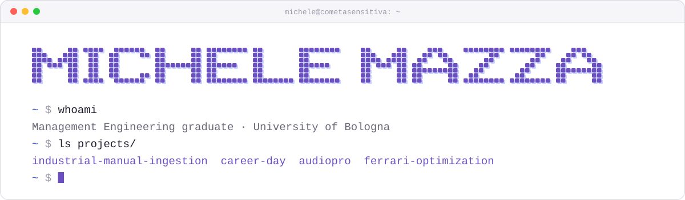
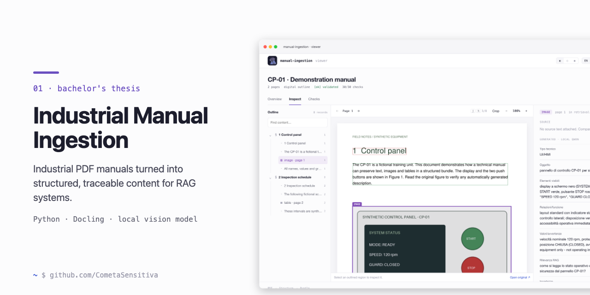
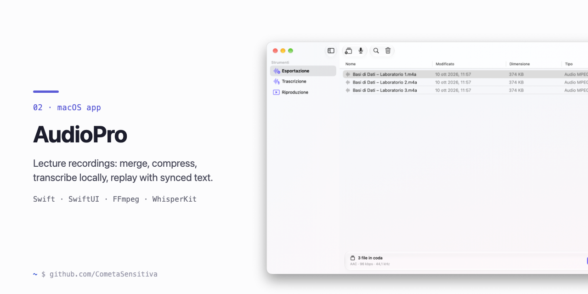
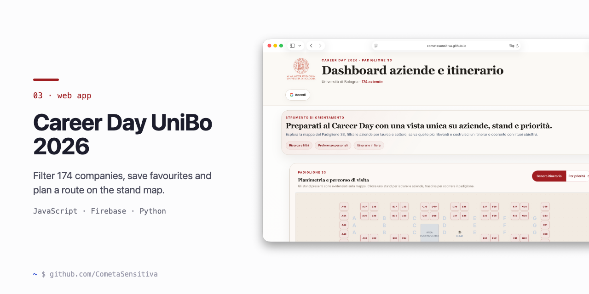
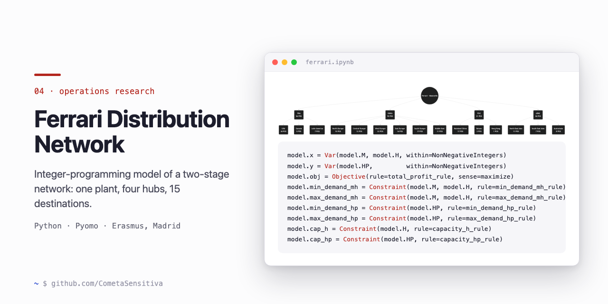

**English** · [Italiano](README.it.md)

<picture>
  <source media="(prefers-color-scheme: dark)" srcset="assets/header-dark.svg">
  
</picture>

I graduated in Management Engineering at the University of Bologna (108/110), after a first year in Computer Engineering and an Erasmus semester in Madrid. I like building practical tools for problems I actually have: documents that are hard to search, lectures that are hard to review, events that are hard to plan.

I learned to program in C and Java during my first year, and today I use coding assistants in my development workflow. I decide what the tool should do and how it is structured, read and question the code, and test the result until it behaves the way it should.

## Selected work

### [Industrial Manual Ingestion](https://github.com/CometaSensitiva/industrial-manual-ingestion)

BACHELOR'S THESIS · PYTHON · LOCAL AI

A Python pipeline that turns industrial PDF manuals into structured, traceable content for RAG systems. Every extracted record points back to its source page; tables are serialized and images described by a vision model running locally.
**[Open the viewer](https://cometasensitiva.github.io/industrial-manual-ingestion/)** · [Thesis (PDF)](https://github.com/CometaSensitiva/university/tree/main/3-anno/tesi)

### [AudioPro](https://github.com/CometaSensitiva/AudioPro)

MACOS APP · SWIFT / SWIFTUI · FFMPEG · WHISPERKIT

A native macOS app for lecture recordings, which I use for my own: merge and compress audio or video, transcribe locally and play it back with a synchronized, clickable transcript.

### [Career Day UniBo 2026](https://github.com/CometaSensitiva/Career-Day-UniBo-2026)

WEB APP · JAVASCRIPT · FIREBASE · PYTHON

A dashboard to prepare a visit to the University of Bologna Career Day: filter the 174 companies, save favourites and plan a route on the stand map. I built it for myself and proposed it to the university; it is not an official service.
**[Open the dashboard](https://cometasensitiva.github.io/Career-Day-UniBo-2026/)**

### [Ferrari Distribution Network Optimization](https://github.com/CometaSensitiva/ferrari-distribution-optimization)

OPERATIONS RESEARCH · PYTHON / PYOMO · ERASMUS, MADRID

My first Python project: an integer-programming model of a two-stage distribution network, built for Investigación Operativa at UAX and graded 10/10. Independent academic exercise, not affiliated with Ferrari.

## From my studies

**[University](https://github.com/CometaSensitiva/university)** — LaTeX notes and formula sheets, the optimization lab, a plant layout project and the thesis, organized by year.

First year of Computer Engineering: [C and data structures](https://github.com/CometaSensitiva/fondamenti-di-informatica-t-1) · [Java and OOP](https://github.com/CometaSensitiva/fondamenti-di-informatica-t-2)

---

[LinkedIn](https://www.linkedin.com/in/michelemazzaa/)
